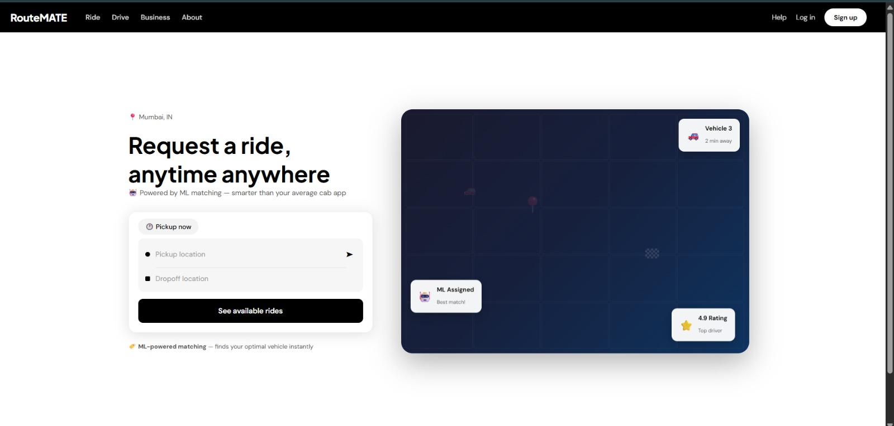
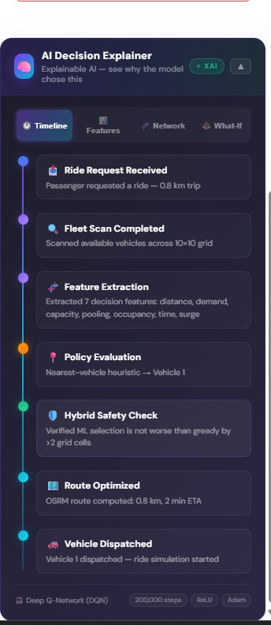
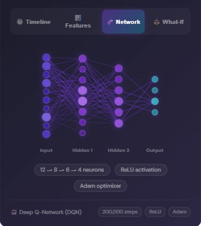
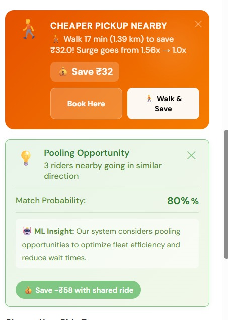
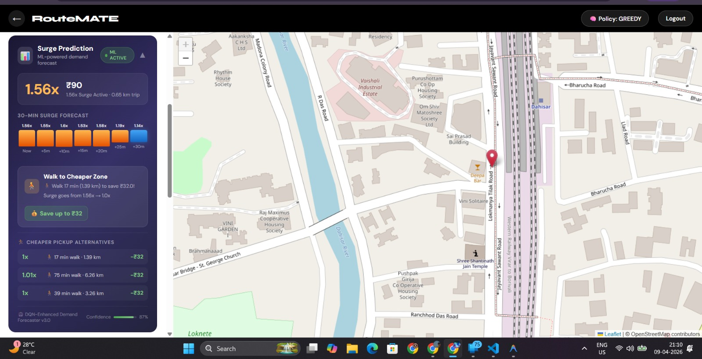
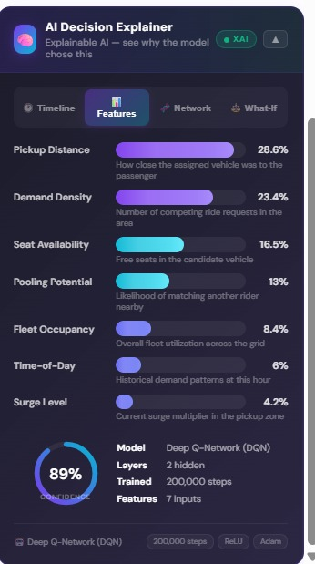

<p align="center">
  
  
  
  
  
</p> 

# RouteMate

ML-based ride-sharing optimization system using reinforcement learning and vehicle pooling, with a FastAPI backend and React frontend.

---

## Features

- Ride-sharing optimization using PPO reinforcement learning
- Vehicle pooling support
- Real-time simulation environment
- Performance comparison with heuristic baselines
- REST API integration using FastAPI
- Interactive frontend visualization using React

---

## Tech Stack

- Python
- Gymnasium
- Stable-Baselines3
- FastAPI
- React
- NumPy
- Pandas
- Matplotlib

---

## Results

- Improved vehicle-request matching efficiency compared to heuristic approaches
- Simulated and evaluated 10,000+ ride requests
- Compared PPO agent against greedy and random baselines
- Implemented vehicle pooling for efficient passenger allocation

---

## Architecture

```text
User Requests
      ↓
Simulation Environment
      ↓
RL Agent (PPO)
      ↓
Vehicle Assignment Engine
      ↓
Metrics & Visualization
```

---

## Setup

### Clone the Repository

```bash
git clone https://github.com/makarand1409/RouteMate.git
cd RouteMate
```

### Create Virtual Environment

```bash
python -m venv venv
```

### Activate Virtual Environment

#### Windows

```bash
venv\Scripts\activate
```

#### Linux/Mac

```bash
source venv/bin/activate
```

### Install Dependencies

From the repository root, with the virtual environment activated:

```bash
python -m pip install -r requirements_phase1.txt
python -m pip install -r requirements_phase2.txt
python -m pip install -r requirements_phase4.txt
```

Install frontend dependencies:

```bash
cd frontend
npm install
cd ..
```

## Run the Project

Start the backend in one terminal from the repository root:

```powershell
.\venv\Scripts\Activate.ps1
cd backend
python -m uvicorn main:app --host 0.0.0.0 --port 8000 --reload
```

Backend URLs:

- API: http://localhost:8000
- Swagger documentation: http://localhost:8000/docs

Start the frontend in a second terminal from the repository root:

```bash
cd frontend
npm start
```

Frontend URL: http://localhost:3000

## Project Structure

```text
backend/       FastAPI application
frontend/      React application
src/           Simulation, environment, and ML code
tests/         Automated tests
outputs/       Models, logs, and evaluation results
```

---

## Future Improvements

- Real-time traffic-aware routing
- Multi-agent reinforcement learning
- Live map integration
- Advanced analytics dashboard

  
---

## 📸 Screenshots

### Application Interface







### Route Optimization





### Model Performance



---

## 🎥 Demo Video

Watch RouteMate in action:

[▶️ Watch the RouteMate Demo](96204 (1).mp4


